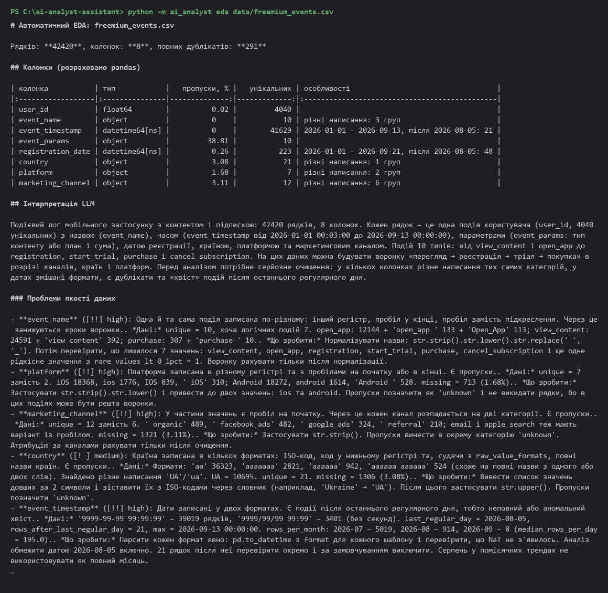
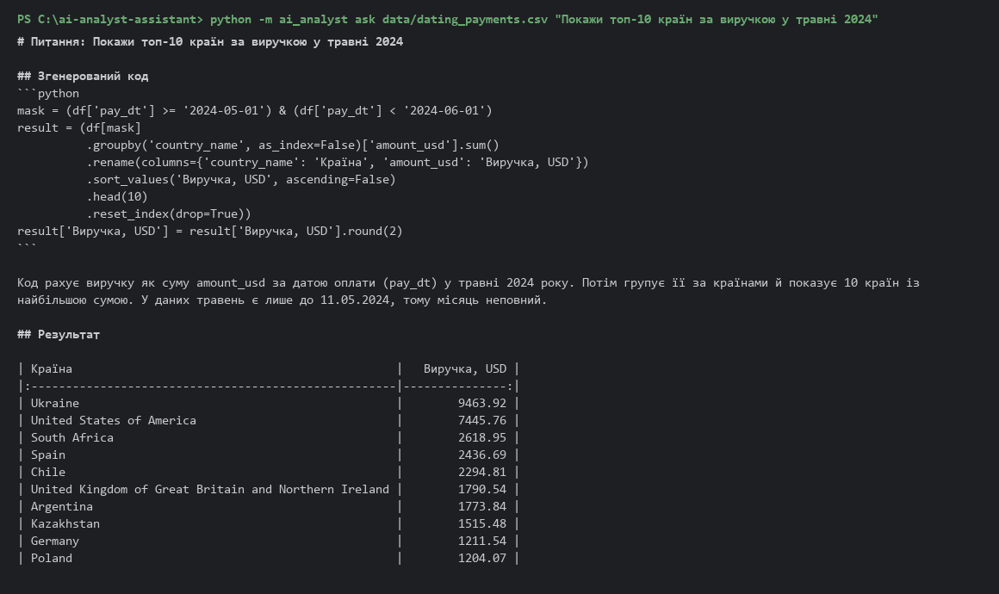
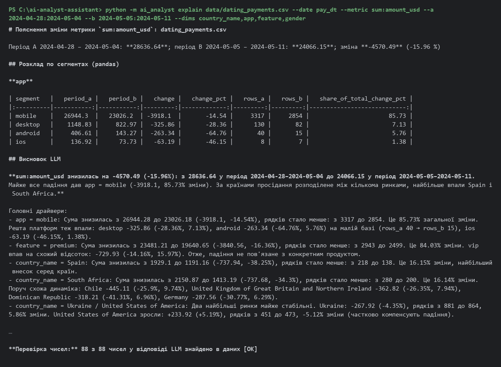

# AI Analyst Assistant

CLI-інструмент на Python, який бере на себе рутинну частину роботи продуктового аналітика: автоматичний EDA, генерацію гіпотез, відповіді на питання природною мовою (з видимим pandas-кодом), пояснення аномалій метрик та executive summary для стейкхолдера.

Головний принцип – **pandas рахує, LLM інтерпретує, код перевіряє**. Усі числа обчислює pandas і передає моделі як факти. Модель (Claude через Anthropic API) лише пояснює їх і повертає структурований JSON за Pydantic-схемою. Після цього модуль `verify` автоматично звіряє кожне число з відповіді моделі з розрахованими фактами й показує ті, яких у даних немає (можливі галюцинації).

## Реалізовані функції

| № | Функція | Команда | Що робить |
|---|---------|---------|-----------|
| 1 | Автоматичний EDA | `eda` | Типи, пропуски, дублікати, розподіли, викиди, різні написання категорій, мішані формати дат, «дати з майбутнього»; LLM формулює проблеми якості та перші висновки |
| 2 | Генерація гіпотез | `hypotheses` | pandas шукає статистично значущі відхилення сегментів (z ≥ 3), тренди, зсуви структури; LLM обирає 5–10 гіпотез з посиланням на факти F1…Fn |
| 3 | Natural language → pandas | `ask` | LLM пише pandas-код, інструмент перевіряє його (AST) і виконує в пісочниці, показує код і результат; при помилці – одна автоматична спроба виправлення |
| 4 | Пояснення аномалій | `explain` | Метрика у двох періодах, внесок кожного сегмента у зміну по розрізах; LLM формулює драйвери, гіпотези причин і наступні перевірки |
| 5 | Executive summary | `summary` | З JSON-набору метрик – короткий текст для CEO: що сталося, чому важливо, що робити |
| 6 | Власна: перевірка галюцинацій | (у кожній команді) | Кожне число з відповіді LLM звіряється з фактами pandas, неперевірені значення виводяться з контекстом |

## Встановлення та запуск

```bash
git clone https://github.com/vadimstb/ai-analyst-assistant.git
cd ai-analyst-assistant
pip install -r requirements.txt
```

Інструмент підтримує два бекенди LLM (вибір автоматичний, або `--backend`):

1. **Anthropic API (основний).** Отримайте ключ на [console.anthropic.com](https://console.anthropic.com) → *API Keys* (потрібен баланс; один запуск коштує центи) і задайте змінну середовища:
   ```bash
   export ANTHROPIC_API_KEY="sk-ant-..."        # Windows PowerShell: $env:ANTHROPIC_API_KEY="sk-ant-..."
   ```
2. **Claude Code CLI (без API-ключа).** Якщо встановлено [Claude Code](https://code.claude.com) і виконано вхід (`claude` → `/login`), інструмент викликає `claude -p --json-schema` і працює через підписку Claude.

Модель за замовчуванням – `claude-opus-5-5`, змінюється через `AI_ANALYST_MODEL`.

```bash
python -m ai_analyst eda data/freemium_events.csv --out report.md
python -m ai_analyst hypotheses data/dating_payments.csv
python -m ai_analyst ask data/dating_payments.csv "Покажи топ-10 країн за виручкою у травні 2024"
python -m ai_analyst explain data/dating_payments.csv --date pay_dt --metric sum:amount_usd \
    --a 2024-04-28:2024-05-04 --b 2024-05-05:2024-05-11 --dims country_name,app,feature
python -m ai_analyst summary examples/metrics_dating_app.json --context "Звіт для CEO"
python -m pytest -q          # офлайн-тести без звернень до LLM
```

Метрика для `explain`: `count`, `sum:<колонка>`, `mean:<колонка>` або `nunique:<колонка>`. Глобальні параметри (`--out`, `--backend`) пишуться перед назвою команди.

Інструмент також можна використовувати з Jupyter:

```python
from ai_analyst import AIAnalyst, load_csv
df = load_csv("data/dating_payments.csv")
res = AIAnalyst().ask(df, "Середній чек по платформах")
print(res["code"]); res["result"]
```

## Демонстрація на реальних даних

Датасети взято з попередніх лабораторних робіт:

- `data/freemium_events.csv` – 42 420 подій freemium-застосунку з атрибутами користувачів (навмисно «брудні» дані: дублікати, різні написання категорій, два формати дат, дати з майбутнього);
- `data/dating_payments.csv` – 11 330 платежів застосунку знайомств із даними реєстрацій і довідником країн.

Повні результати кожної команди збережено в папці [`examples/`](examples/):

| Файл | Що показує |
|------|-----------|
| [01_eda_freemium_events.md](examples/01_eda_freemium_events.md) | EDA знайшов 9 проблем якості (сім варіантів запису платформи, пробіли в каналах, мішані формати дат, 21 подію після 2026-08-05 тощо); перевірка: 150 з 150 чисел |
| [02_hypotheses_dating_payments.md](examples/02_hypotheses_dating_payments.md) | 9 гіпотез з посиланнями на факти; перевірка: 89 з 89 чисел знайдено в даних |
| [03a_ask.md](examples/03a_ask.md), [03b_ask.md](examples/03b_ask.md) | Питання природною мовою → pandas-код → таблиця |
| [03c_ask.md](examples/03c_ask.md) | Крайній випадок: питання не про дані («прогноз погоди») – інструмент відмовляє з поясненням |
| [03d_ask.md](examples/03d_ask.md) | Крайній випадок: retention без даних про активність – модель явно називає припущення |
| [04_explain_revenue_drop.md](examples/04_explain_revenue_drop.md) | Падіння тижневої виручки на 15,96 %: 85,7 % зміни дав сегмент app = mobile; перевірка 88 з 88 |
| [05_executive_summary.md](examples/05_executive_summary.md) | Summary для CEO; перевірка 41 з 41 |
| [06_prompt_v0_hypotheses.json](examples/06_prompt_v0_hypotheses.json) | Експеримент з наївним промптом v0 для порівняння (див. prompts.md) |

Скріншоти роботи в терміналі – у папці [`docs/screenshots/`](docs/screenshots/).





## Як це влаштовано

```
ai_analyst/
  profiling.py   – усі обчислення pandas: профіль, факти для гіпотез, розклад зміни метрики
  prompts.py     – системні промпти та Pydantic-схеми відповідей
  llm.py         – бекенди: Anthropic SDK (messages.parse) і Claude Code CLI (--json-schema)
  safe_exec.py   – статична перевірка (AST) та виконання згенерованого коду в пісочниці
  verify.py      – перевірка чисел у відповіді LLM
  assistant.py   – п'ять функцій асистента
  report.py      – Markdown-звіти
  __main__.py    – CLI
tests/           – офлайн-тести з фейковим бекендом
prompts.md       – документація промптів та історія ітерацій
```

Безпека виконання коду: згенерований код не може імпортувати модулі, звертатися до атрибутів з `_`, читати чи записувати файли (`open`, `to_csv`, `read_*`), викликати `eval/exec/getattr`. Він працює з копією DataFrame і обмеженим набором вбудованих функцій. Для навчального прототипу цього достатньо, для продакшену код варто запускати в окремому процесі або контейнері з обмеженням часу.

## Технології

Python 3.11, pandas, NumPy, Pydantic 2, Anthropic Python SDK (structured outputs через `messages.parse`), Claude Code CLI (альтернативний бекенд), tabulate, pytest.
